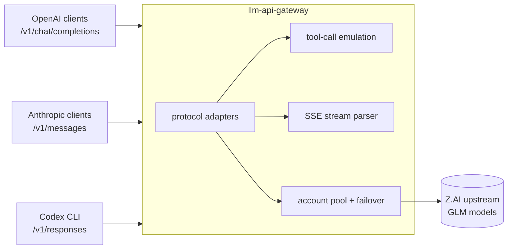

# llm-api-gateway

[](https://github.com/g-alex/llm-api-gateway/actions/workflows/ci.yml)
[](https://pkg.go.dev/github.com/g-alex/llm-api-gateway)
[](LICENSE)

A multi-protocol LLM API gateway written in Go. It exposes an OpenAI-compatible API, the Anthropic Messages API and the OpenAI Responses API on one port, and serves them all from a single upstream — the Z.AI chat backend (GLM model family).

Any client that speaks OpenAI, Anthropic or Responses — from `curl` and the OpenAI SDKs to Claude Desktop and Codex CLI — can talk to the same backend through this gateway.



## Features

- **Three wire protocols, one gateway** — `/v1/chat/completions` (OpenAI), `/v1/messages` (Anthropic, including streamed `content_block` events), `/v1/responses` (OpenAI Responses API for Codex CLI).
- **Streaming everywhere** — server-sent events with a stateful parser that handles upstream `edit_content` rewrites, `<details>` reasoning blocks and UTF-16 edit indices.
- **Account pool with failover** — one JWT per line; accounts are validated at startup, dead ones are skipped, mid-session `401`/`USER_BLOCKED` rotates to the next account and retries. Guest session as the last-resort fallback.
- **Tool calling without native support** — a strict prompt contract plus a multi-strategy output parser and a streaming interceptor turn plain text into OpenAI-style `tool_calls` deltas (with malformed-JSON salvage).
- **Vision input** — image parts (http(s) URLs and `data:` URLs) are uploaded to the upstream file endpoint and referenced as attachments (requires a logged-in token).
- **Embedded dashboard** — live status, session info and quickstart snippets at `/`.

## Quick start

### From source

```bash
git clone https://github.com/g-alex/llm-api-gateway.git
cd llm-api-gateway
cp .env.example .env   # then edit: AUTH_TOKEN is required
go run ./cmd/gateway
```

### Docker

```bash
docker run --rm -p 5082:5082 \
  -e AUTH_TOKEN=my-test-token \
  ghcr.io/g-alex/llm-api-gateway:latest
```

### Binaries

Prebuilt binaries for Linux, Windows and macOS are published on the [releases page](../../releases) for every `v*` tag.

## Configuration

All settings come from environment variables and an optional `.env` file (real environment variables win).

| Variable | Default | Description |
|---|---|---|
| `AUTH_TOKEN` | — (**required**) | Bearer token API clients must send. The server refuses to start without it. |
| `ZAI_TOKEN` | *(empty)* | Z.AI JWT (chat.z.ai → DevTools → Local Storage → `token`). Empty → guest session (limited model set, no image input). |
| `PORT` / `HOST` | `5082` / `0.0.0.0` | Listen address. |
| `LOG_LEVEL` | `info` | `debug` \| `info` \| `warn` \| `error`. |
| `USE_ACCOUNT_POOL` | `false` | Enable the account pool from `ZAI_TOKENS_FILE`. |
| `ZAI_TOKENS_FILE` | `zai_tokens.txt` | Account pool file: one JWT per line, `#` comments allowed. |
| `TIMEOUT` | `300000` | Request timeout, milliseconds. |
| `CLAUDE_DESKTOP` | `false` | Expose `claude-*` model aliases and accept Claude model names. |
| `PERSIST_HISTORY` | `false` | Keep in-memory conversation context per `X-Session-Id`. |
| `ANTHROPIC_ZAI_MIN_MS` | `1500` | Min gap between upstream sends for `/v1/messages`. |

## API examples

With `AUTH_TOKEN=my-test-token` and the server on `:5082`:

**OpenAI — chat completion (streaming)**

```bash
curl -N http://localhost:5082/v1/chat/completions \
  -H "Content-Type: application/json" \
  -H "Authorization: Bearer my-test-token" \
  -d '{
    "model": "glm-4.7",
    "stream": true,
    "messages": [{"role": "user", "content": "Hello!"}]
  }'
```

**Anthropic — messages**

```bash
curl http://localhost:5082/v1/messages \
  -H "Content-Type: application/json" \
  -H "Authorization: Bearer my-test-token" \
  -d '{
    "model": "glm-4.7",
    "max_tokens": 1024,
    "messages": [{"role": "user", "content": "Hello!"}]
  }'
```

**Tools**

```bash
curl http://localhost:5082/v1/chat/completions \
  -H "Content-Type: application/json" \
  -H "Authorization: Bearer my-test-token" \
  -d '{
    "model": "glm-4.7",
    "messages": [{"role": "user", "content": "What is the weather in Berlin?"}],
    "tools": [{
      "type": "function",
      "function": {
        "name": "get_weather",
        "description": "Get current weather for a city",
        "parameters": {
          "type": "object",
          "properties": {"city": {"type": "string"}},
          "required": ["city"]
        }
      }
    }]
  }'
```

## Project layout

```
cmd/gateway/          entry point: config, wiring, graceful shutdown
internal/config/      environment configuration + validation
internal/sse/         stateful upstream stream parser (edit_index, details split)
internal/zai/         upstream client: session, account pool, model catalog,
                      vision uploads, streaming completions with retry/failover
internal/tools/       tool-call emulation: contract, parsers, stream interceptor
internal/api/         HTTP layer: auth, CORS, routes, protocol adapters, dashboard
```

## Development

```bash
go build ./...     # build everything
go vet ./...       # static checks
go test ./...      # unit + integration tests (httptest fake upstream)
go test -race -cover ./...
gofmt -l .         # must print nothing
```

CI runs the same checks (plus golangci-lint) on every push; releases build cross-compiled binaries and a Docker image on `v*` tags.

## Roadmap

- [ ] Outbound proxy rotation with dead-marking
- [ ] Prometheus metrics endpoint
- [ ] Request/response logging with correlation IDs

## License

[MIT](LICENSE)
